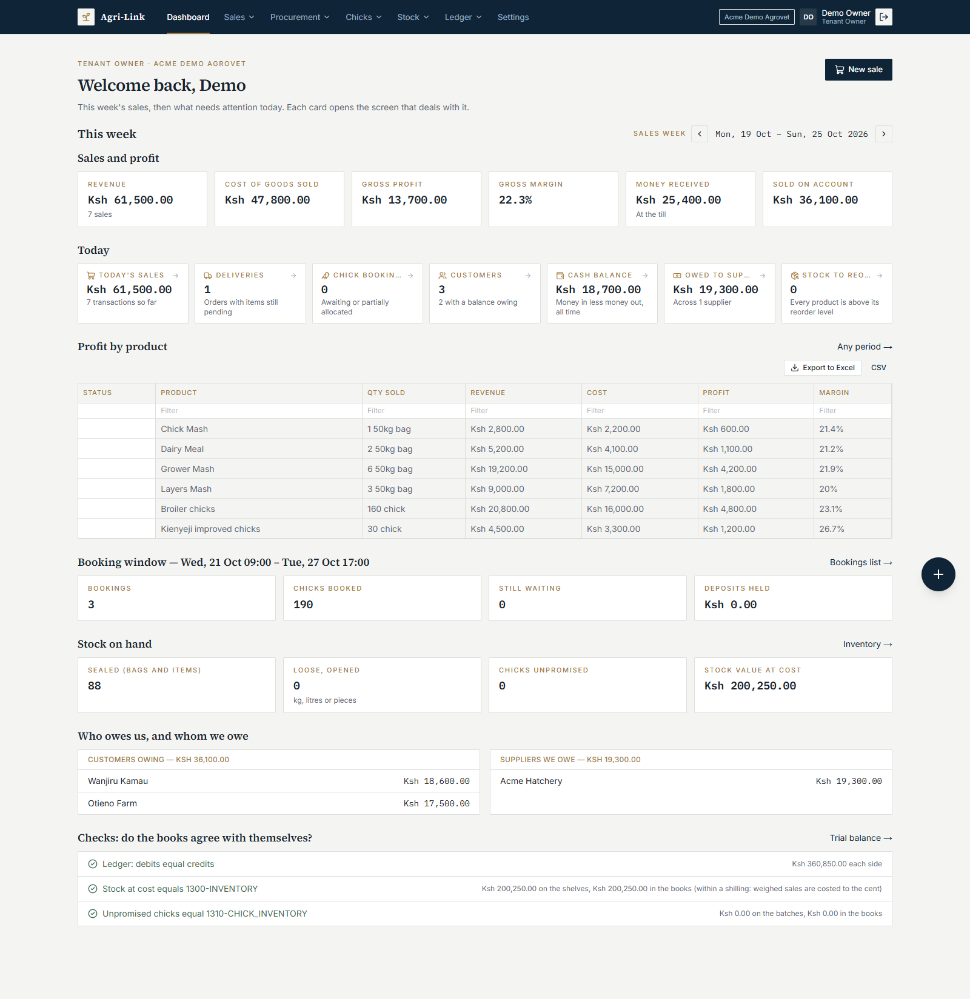
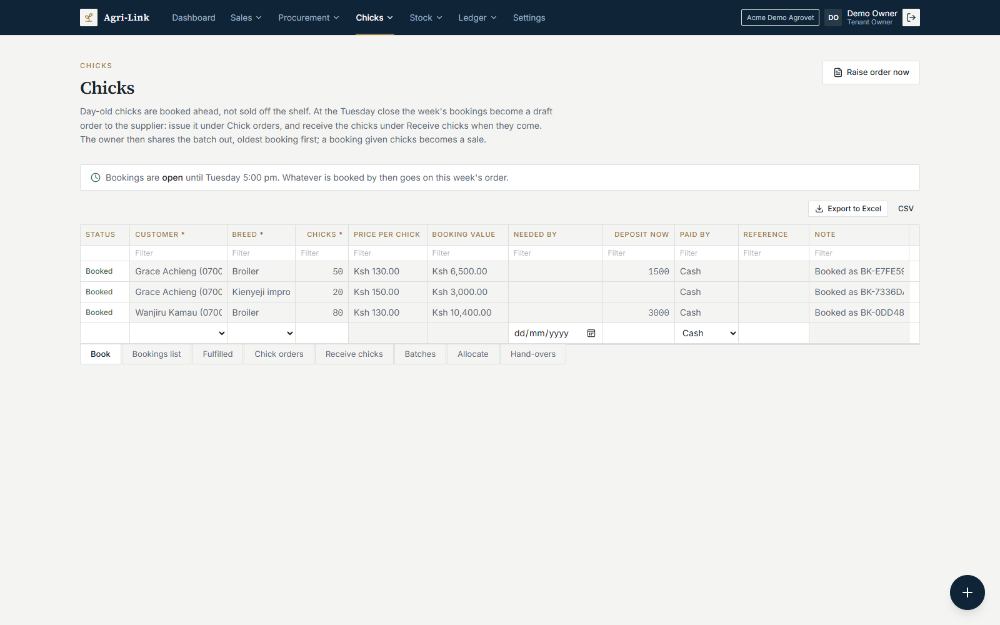
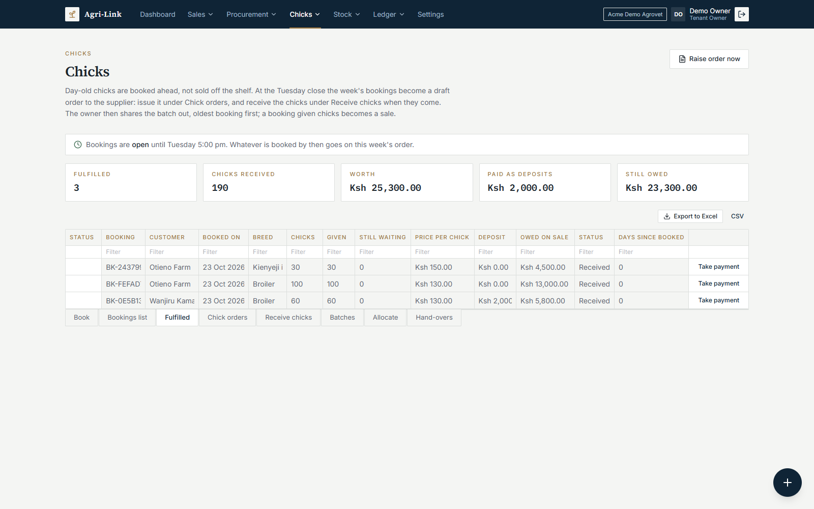
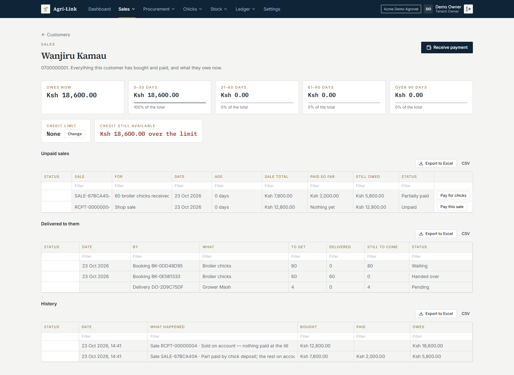
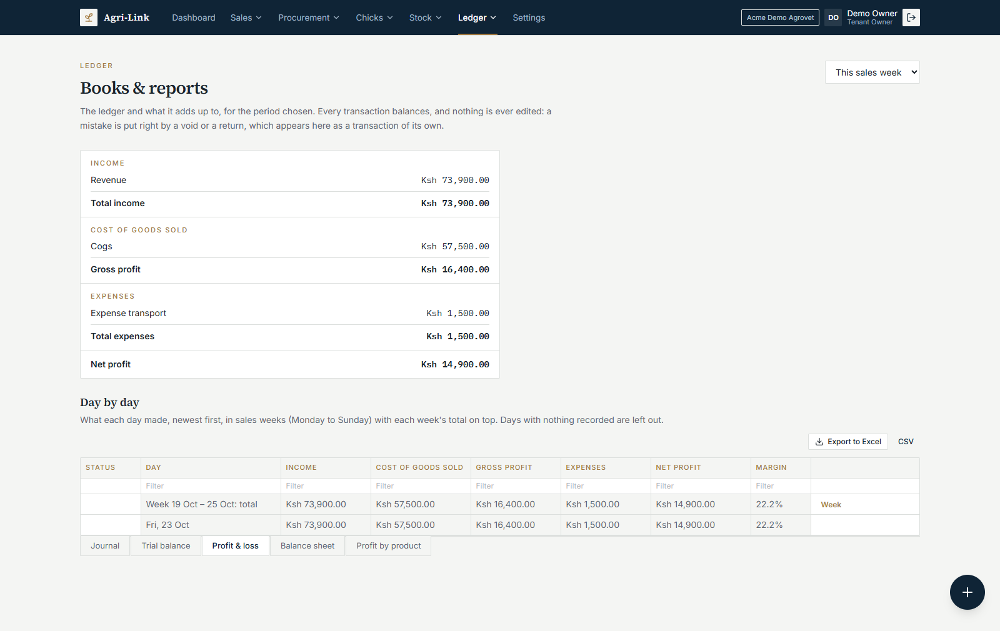
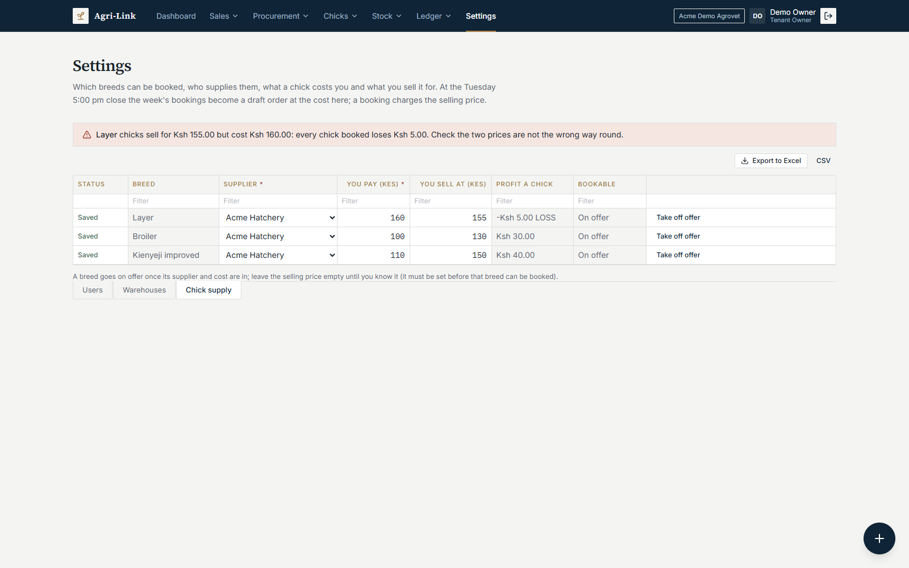
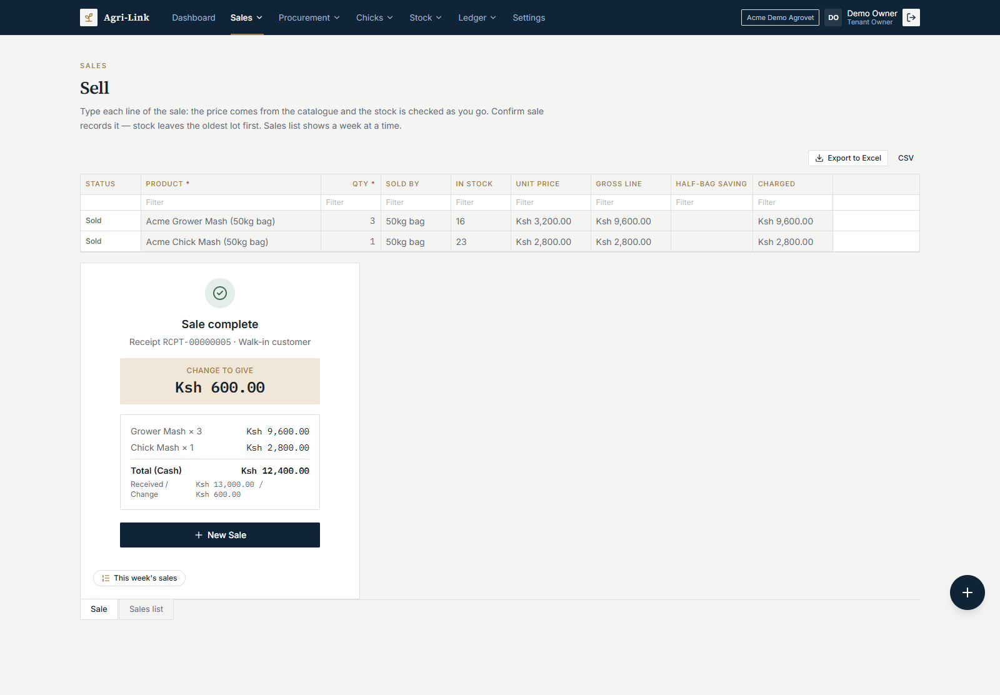
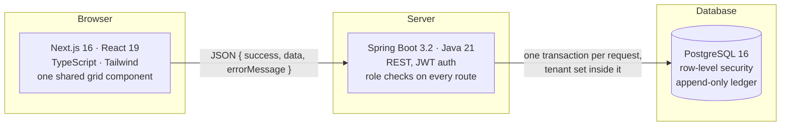

# AgriLink

**An ERP and point of sale for agrovets: the shops that sell feeds, farm supplies and day-old chicks.**

AgriLink runs the whole shop: the till, stock and warehouses, purchase orders and goods received, customers on account, a weekly chick-booking cycle, and a double-entry ledger that every sale, payment and delivery posts to. It is built for a real agrovet in Kenya and is being trialled in the shop.

> The source code is private. This repository shows what the system does and how it is built.

*Screenshots are from a demo shop with made-up names.*

---

## What it does

| Area | What the shop gets |
|---|---|
| **Sell** | A spreadsheet-style till: type the product, the price comes from the catalogue, stock is checked as you go. Cash, M-Pesa, bank or on account. Half bags sold loose at a fair per-kg price. Voids and returns, never edits. |
| **Stock** | Products by category, stock in lots per warehouse, sold oldest first (FIFO). Opening a sealed bag into loose stock. Corrections with a reason. Reorder levels. |
| **Purchases** | Purchase orders saved as drafts, issued to the supplier, received against (short, over or dearer deliveries are flagged), returned. What is owed to each supplier, by age. |
| **Customers** | Accounts with credit limits, what each owes by age (0–30, 31–60, 61–90, 90+ days), part payments, money held on account and applied automatically, deliveries still to send. |
| **Chicks** | Bookings taken all week; at the Tuesday 5 pm close they become a draft order to the hatchery. When the chicks arrive, the batch is shared out oldest booking first, and each booking given chicks becomes a sale. Deposits, part deliveries, cancellations with refunds. |
| **Books & reports** | The journal, trial balance, profit and loss (also day by day, in weeks), balance sheet and profit by product, for any period. The dashboard checks the books agree with the stock on the shelves. |
| **Settings** | Users (owner and sales officer roles), warehouses, chick breeds and prices. A breed priced below cost is flagged. |

Every list is a grid that filters, sorts and exports to Excel. Tabs along the bottom group related sheets, the way the shop's own spreadsheet did.

---

## Screenshots

| | |
|---|---|
|  **Booking chicks:** one row per breed. "Book all together" books a customer's breeds as one, all or nothing. |  **Fulfilled bookings:** once a batch is shared out, served bookings leave the waiting list. |
|  **A customer's account:** what they owe by age, unpaid sales, what has been delivered and what is still to come, and the full history. |  **Profit and loss:** the statement for the period, then each day's figures grouped into sales weeks. |
|  **Chick prices:** cost and selling price per breed; selling below cost is caught before a booking is taken. |  **Sell:** the till as a grid. The price comes from the catalogue, stock is checked as you type, and Confirm records the sale. |

---

## Architecture

- **Backend:** Spring Boot 3.2 on Java 21, Spring Security with JWT, Spring Data JPA, Flyway (35 migrations), Bucket4j rate limiting on sign-in and password reset.
- **Frontend:** Next.js 16 and React 19 in TypeScript, Tailwind CSS, the React Compiler. No UI library: the grid, the tabs and the modals are built in the project.
- **Database:** PostgreSQL 16, run in Docker Compose with a catch-all mail inbox for password-reset emails in development.
- **Tests:** 106 backend tests against a real PostgreSQL started by Testcontainers, plus browser tests (Playwright) that drive each screen end to end against a throwaway stack.

---

## Engineering decisions worth a look

**The database enforces who sees what.** Every business table has a PostgreSQL row-level-security policy, forced even for the table owner. The backend sets the business on each transaction with `set_config(..., true)`, so the setting cannot leak to the next request on a pooled connection. A query that forgets to filter by business still returns only that business's rows. The application connects as a role with no rights to change the schema; migrations run under a second role.

**The ledger cannot lie.** Every sale, payment, delivery, return and expense posts a balanced double-entry transaction. A database trigger refuses any update or delete on ledger rows, and a deferred constraint trigger refuses to commit a transaction whose debits and credits differ. A mistake is put right by a void or a return, which posts its own reversing entries. The dashboard then checks that stock at cost equals the inventory account, and that unpromised chicks equal the chick-inventory account.

**Nothing is recorded twice.** Every screen that records money or stock sends an idempotency key, unique per business at the database level. A sale retried after a dropped connection, a double-clicked payment, or a chick booking sent twice is recorded once, and the retry gets the original back. An M-Pesa transaction code can be used only once per business, enforced by a unique index.

**Stock and money are safe under concurrency.** Stock lots and account balances are locked with row locks while they change, so two tills selling the last bag at the same moment cannot both succeed. Stock leaves the oldest lot first, and each sale line is costed from the lots it actually drew on, so profit by product is exact.

**Business rules live on the server.** Catalogue prices, whole units for counted products, credit limits, the booking window (Wednesday 09:00 to Tuesday 17:00, Nairobi time) and role checks are all enforced by the backend. The screens mirror them only to give a clear message early.

**One grid for every screen.** The rebuild replaced form-based screens with a single spreadsheet-style component, so the shop's staff work the way they did in Excel:
- Keyboard navigation, pasting a block from Excel, a filter on every column, and Excel or CSV export.
- Editable records save themselves as each cell is left.
- Records that move money or stock stay drafts until Confirm, then lock.
- Typing during a save is never lost, a refused row keeps what was typed, and rows never jump while being edited.

**Chicks are a weekly cycle, not stock on a shelf.** Bookings close on Tuesday evening and become a draft purchase order. A batch that arrives is shared out oldest booking first, with the owner able to adjust the split. A booking given only part of its chicks is split: the part delivered becomes a sale, and the rest keeps its place in the queue.

---

## Status

The trial in the shop starts in October 2026. The system serves one business per deployment, with the row-level security kept, so separate shops' data never meets.

---

*Built by [TofaKM](https://github.com/TofaKM). The source code is private; ask me for a walkthrough.*
